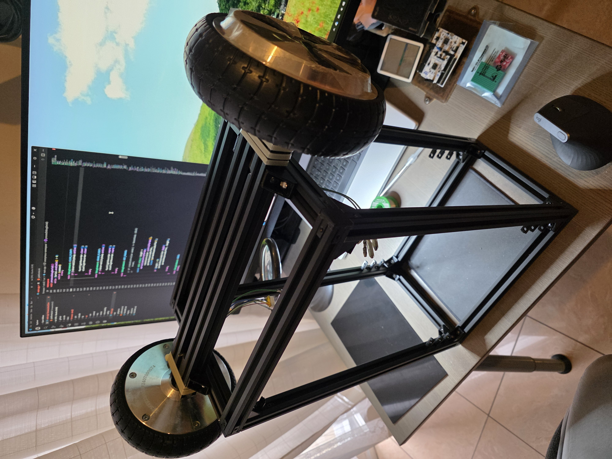

# TARI — Teleoperated Autonomous Robotic Intelligence

**An experimental two-wheeled self-balancing robot exploring embedded control, telepresence, distributed robotics, and Physical AI.**

TARI is a personal robotics R&D project focused on designing and integrating a robotic platform, from low-level embedded control to high-level perception, teleoperation, and autonomous capabilities.

The project is under active development. The embedded software foundation is implemented and covered by automated unit tests; hardware integration and physical balancing validation are the next major steps.

## Prototype



*Early mechanical prototype. Hardware integration and bring-up are in progress.*

## System Architecture

TARI separates real-time motor control and low-level safety from higher-level robotics applications.

| Layer | Responsibilities | Status |
|---|---|---|
| STM32 firmware | IMU acquisition, attitude estimation, motor control, safety, diagnostics | Implemented; hardware validation ongoing |
| Motor controller | Dual BLDC motor actuation over CAN | Integration pending |
| Linux computer | Teleoperation, communication, telemetry, ROS 2 integration | Planned |
| AI and autonomy | Perception, interactive assistant, autonomous behavior | Planned |

The architecture is designed so that loss of the Linux computer or network connectivity does not compromise low-level robot safety. This is a design objective that still requires system-level validation.

## Hardware

| Component | Description |
|---|---|
| Microcontroller | STM32 NUCLEO-G474RE |
| Motor controller | ODESC 3.6 Dual |
| Motors | 2 × 36 V / 350 W BLDC hub motors |
| IMU | LSM6DSV16X |
| Communication | CAN bus between STM32 and motor controller |
| Chassis | Custom mechanical prototype with two hub wheels |

## Embedded Software

The firmware is written in C++ using PlatformIO and the Arduino STM32 framework.

Its main components include:

- **Motor control:** ODESC CAN protocol, motor commands, status monitoring and torque limiting.
- **Control:** attitude estimation, balance control, motion commands and parameter validation.
- **Safety:** safety state management, watchdogs, command timeouts and tilt monitoring.
- **Observability:** diagnostics, event recording and flight-recorder support.
- **Testing:** host-based unit tests for core software components.

The implementation is organized under [`firmware/stm32/`](firmware/stm32/).

## Build and Verification

The current firmware baseline has passed:

- **242 unit tests** across 31 host-based test suites.
- A successful firmware build targeting STM32 NUCLEO-G474RE.

To build the firmware:

```bash
cd firmware/stm32
pio run -e nucleo_g474re
```

To run unit tests:

```bash
cd firmware/stm32
pio test -e native
```

Passing host-based tests and compiling the firmware do not establish correct physical balancing behavior or real-time performance on the target hardware.

## Development Roadmap

1. **Embedded software foundation:** modular firmware, CAN motor interface, safety mechanisms, diagnostics and unit testing.
2. **Hardware bring-up:** ODESC configuration, motor calibration, IMU verification and CAN communication tests.
3. **System integration and balancing:** wiring, PC-based diagnostics and configuration, live telemetry, control tuning and physical balance testing.
4. **High-level robotics:** Linux integration, teleoperation, audio/video communication and ROS 2 experimentation.
5. **AI and autonomy:** interactive AI assistance, perception and autonomous robotic capabilities.

See [`docs/ROADMAP.md`](docs/ROADMAP.md) for detailed milestones and development status.

## Repository Structure

```text
tari/
├── firmware/
│   └── stm32/          # Embedded control firmware and tests
└── docs/
    ├── ROADMAP.md      # Public development roadmap
    └── images/         # Prototype photographs
```

This diagram shows the public-facing project structure. Additional internal development material is maintained separately.

## Development Approach

TARI combines hands-on hardware experimentation with software engineering practices including modular architecture, automated testing, diagnostics and incremental integration.

AI-assisted development tools, including ChatGPT and OpenAI Codex, are used for design discussions, implementation assistance, code review and testing. The project is developed and validated through an iterative engineering workflow.

## Current Status

**Experimental prototype — active development.**

The current focus is hardware bring-up, motor-controller integration and preparation for initial balancing experiments.

The project is not yet a fully integrated or operational self-balancing robot.
